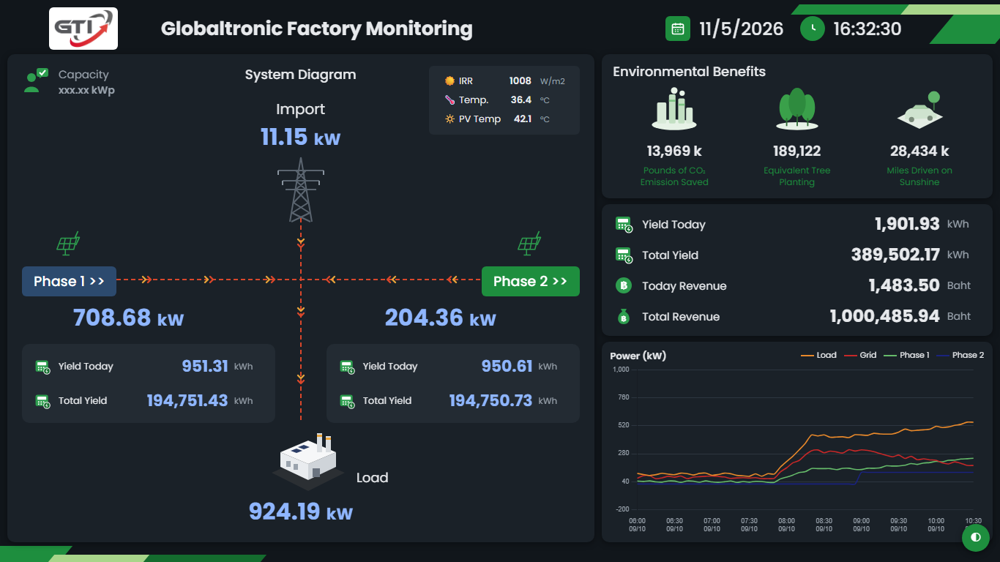
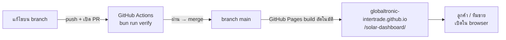

# GTI Solar Solutions — Demo Hub

รวมหน้าตัวอย่างสำหรับ**เปิดให้ลูกค้าดู**ของธุรกิจโซลาร์ Globaltronic Intertrade ได้แก่ เครื่องคำนวณความคุ้มค่า
และ template แดชบอร์ดติดตามระบบหลังติดตั้ง เป็นเว็บ static ล้วน (HTML/CSS/JS ไม่มี backend)
เผยแพร่ผ่าน GitHub Pages:

**https://globaltronic-intertrade.github.io/solar-dashboard/**

> **repo นี้เป็น public** — ทุกหน้าใช้**ข้อมูลตัวอย่าง**เท่านั้น ห้ามใส่ชื่อ โลโก้ รูป วิดีโอ หรือข้อมูลจริงของลูกค้า
> งานติดตั้งจริงของลูกค้าแต่ละรายอยู่ใน private repo ของตัวเอง



|              |                                                                                 |
| ------------ | ------------------------------------------------------------------------------- |
| เจ้าของ      | Globaltronic Intertrade · Solar Solutions                                       |
| ผู้รับผิดชอบ | ทีม Edutronics (Tech Lead: Ioun)                                                |
| Stack        | HTML/CSS/JS ล้วน · Chart.js / ECharts จาก CDN · Prettier · Bun (เครื่องมือ dev) |
| ที่รัน       | GitHub Pages (branch `main`) — เปิดได้จาก browser ทุกเครื่อง                    |

## หน้าทั้งหมด

| หมวด                  | หน้า                                                   | ใช้ทำอะไร                                                                               |
| --------------------- | ------------------------------------------------------ | --------------------------------------------------------------------------------------- |
| —                     | [`/`](index.html)                                      | หน้า landing รวมลิงก์ทุก demo แบ่งตามหมวด                                               |
| ประเมินความคุ้มค่า    | [`calculator/`](calculator/index.html)                 | **SolarSave** — คำนวณค่าไฟที่ประหยัดได้ ระยะคืนทุน และกำไรสุทธิ 25 ปี                   |
| ติดตามระบบหลังติดตั้ง | [`factory-monitoring/`](factory-monitoring/index.html) | Factory Monitoring — การผลิตไฟของโรงงาน พร้อมผลด้านสิ่งแวดล้อม (ข้อมูลขยับทุก 5 วินาที) |
| ติดตามระบบหลังติดตั้ง | [`plant-overview/`](plant-overview/index.html)         | Plant Overview — ภาพรวมโรงไฟฟ้า การจัดการพลังงาน และรายได้                              |
| ติดตามระบบหลังติดตั้ง | [`solar-overview/`](solar-overview/index.html)         | Solar Overview — การผลิตพลังงาน แบตเตอรี่ และ power flow                                |

### SolarSave (calculator)

ผู้ใช้ปรับ slider 5 ตัว: ขนาดระบบ (kWp) · ค่าไฟปัจจุบัน (บาท/เดือน) · อัตราค่าไฟ (บาท/หน่วย) ·
ชั่วโมงแสงแดดต่อวัน (3–6) · ต้นทุนติดตั้ง (20–50 บาท/Wp) แล้วได้ผลทันที: ประหยัดต่อปีและต่อเดือน ·
ไฟที่ผลิตได้ต่อปี · เงินลงทุน · ระยะคืนทุน · กำไรสุทธิ 25 ปี พร้อมกราฟ

สมมติฐานที่ใช้ (แสดงไว้ในหน้าด้วย): ประสิทธิภาพระบบ 80% · แผงเสื่อม 0.5%/ปี · ค่าไฟขึ้นเฉลี่ย 3%/ปี ·
On-grid ไม่มีแบตเตอรี่ · อายุแผง 25 ปี · ไม่รวมค่าบำรุงรักษา (~2,000 บาท/ปี)

## การทำงาน



- `main` คือของจริงที่ลูกค้าเห็น — **ห้าม push ตรงเข้า `main`** ทุกการแก้ต้องผ่าน PR
- CI (`.github/workflows/verify.yml`) ตรวจ format และลิงก์ภายในที่เสีย — แก้แค่ไฟล์ `.md` จะไม่รัน CI
- กราฟโหลด Chart.js / ECharts และฟอนต์จาก CDN — เครื่องที่เปิดต้องต่อเน็ต

### แสดงเต็มจอไม่ต้อง scroll

แดชบอร์ดทั้ง 3 หน้าโหลด `assets/fit-screen.js` ซึ่งย่อ/ขยายทั้งหน้าให้พอดีจอแนวนอน (กว้างตั้งแต่ 1201 px)
หน้าตาจึงเหมือนกันทั้งบนโน้ตบุ๊ก 1366×768, MacBook และทีวี 1920×1080 ส่วนจอแคบหรือแนวตั้ง (มือถือ แท็บเล็ต)
ใช้ layout ปกติของหน้าและ scroll ได้ตามเดิม

- เปิดโชบนทีวี: เปิดหน้าแล้วกด `F11` (เต็มจอ) ได้เลย
- ปิดการย่อขยาย: ต่อท้าย URL ด้วย `?fit=0` เช่น `factory-monitoring/?fit=0`

## เริ่มใช้งาน (สำหรับคนแก้ไข)

ต้องมี [Bun](https://bun.sh) และ Python 3 (ใช้เปิด server ดูตัวอย่างในเครื่อง)

```bash
bun install
bun run serve    # เปิด http://127.0.0.1:8765
```

ก่อน commit:

```bash
bun run format   # จัด format ด้วย Prettier
bun run verify   # ตรวจ format + ลิงก์/รูป/ไฟล์ภายในที่หาไม่เจอ (ตัวเดียวกับที่ CI รัน)
```

### เพิ่มหน้า demo ใหม่

1. สร้างโฟลเดอร์ชื่อ kebab-case มีไฟล์ `index.html` (เช่น `battery-monitor/index.html`)
2. ใส่ favicon และโลโก้จาก `assets/gti-logo.png` · ใช้ข้อมูลตัวอย่างและชื่อ Globaltronic เท่านั้น ·
   ถ้าเป็นแดชบอร์ด ใส่ `<script src="../assets/fit-screen.js"></script>` เป็นบรรทัดแรกใน `<body>`
3. เพิ่มการ์ดลิงก์ในหมวดที่เหมาะสม ใน dictionary `MESSAGES` ของ `index.html` (ข้อความบนหน้า landing อยู่ที่นี่ที่เดียว)
4. เพิ่มแถวในตาราง "หน้าทั้งหมด" ของ README นี้ แล้วเปิด PR

## โครงสร้างโปรเจกต์

```
index.html                 หน้า landing + dictionary ข้อความ MESSAGES
assets/gti-logo.png        โลโก้ GTI (ใช้เป็น favicon ทุกหน้า)
assets/fit-screen.js       ย่อ/ขยายแดชบอร์ดให้เต็มจอไม่ต้อง scroll
docs/                      ภาพหน้าจอใน README
calculator/                SolarSave — เครื่องคำนวณความคุ้มค่า
factory-monitoring/        template Factory Monitoring
plant-overview/            template Plant Overview
solar-overview/            template Solar Overview
scripts/check-links.mjs    ตรวจว่า src/href/url() ภายในทุกไฟล์มีอยู่จริง
.github/workflows/         CI: bun run verify
package.json               scripts format / verify / serve
.prettierrc.json           กติกา format (printWidth 100, singleAttributePerLine)
```

## สิ่งที่ยังขาด

- หน้าที่ย้ายมาจาก repo เดิม (template 3 หน้า + calculator) ยังเขียนข้อความและสีไว้ในหน้าตรงๆ
  ยังไม่ได้ผ่าน dictionary กลางและ design token

## สำหรับ AI assistant

คู่มือสำหรับ coding agent: [`AGENTS.md`](AGENTS.md)
